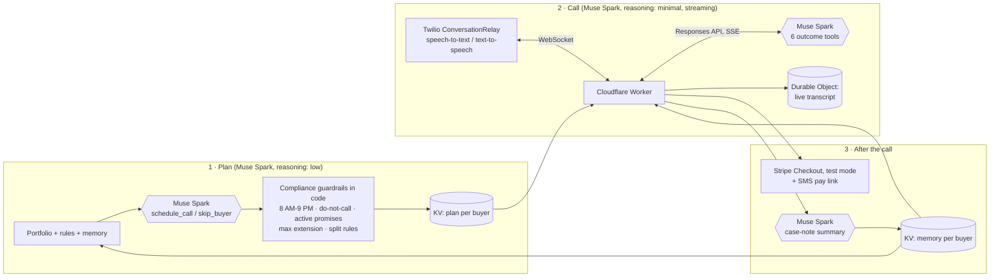

# PayMind Voice: bilingual AI collections calls for Buy-Here-Pay-Here car dealers

**▶ Live demo (it really calls your phone):** https://paymind-voice-hackathon.joarciniegas.workers.dev
**Built with:** Muse Spark 1.3 (Meta Model API) · Twilio ConversationRelay · Cloudflare Workers, KV and Durable Objects · Stripe (test mode)
**Team:** [BizMind AI Agency](https://bizmind.us), Houston, TX · Meta Global AI Developer Hackathon, Startup Track (*Build for Your World*)

---

## The problem

Buy-Here-Pay-Here (BHPH) dealerships finance their own cars, mostly for buyers that banks turn down. Their business depends on collections, so someone on the lot spends hours every day calling late buyers:

- **Many calls reach the wrong person.** Telling a relative about the debt can break collection laws, so every call has to confirm identity first.
- **Many buyers speak Spanish.** In Houston that is often the majority of them.
- **There are rules about what you can't say:** no threats, no invented fees, no calls before 8 AM or after 9 PM, and the rep has to remember who asked not to be called again.
- **Nobody remembers what the buyer said last week.** "My son's dentist bill, I'll pay Friday" lives in someone's head or on a sticky note.

Big lenders have call centers for this. A 40-car lot on the south side of Houston has one person and a spreadsheet.

## What PayMind Voice does

| | |
|---|---|
| 🧠 **Plans the day** | Muse Spark reads the whole portfolio, the dealer's rules and each buyer's history, then decides **who to call, when and with which opening offer**, using tool calls (`schedule_call`, `skip_buyer`). The code then enforces compliance on top of its plan. |
| 📞 **Makes the call** | It speaks English or Spanish, **confirms identity before saying a single word about the debt**, explains the balance and negotiates a date within the dealer's limits. First words come in about 1 second. |
| 🛠️ **Acts with tools** | Each call ends in exactly one outcome, chosen by Muse Spark through function calling: `record_promise`, `send_pay_link`, `transfer_to_human`, `do_not_call`, `wrong_person` or `end_call`. |
| 💳 **Gets paid** | On a promise, the buyer gets a text with a secure Stripe pay link for the agreed amount. |
| 🗂️ **Remembers** | After hanging up, Muse Spark writes a two-line case note. The next call opens with it ("Last time you told me you'd pay Friday…"). |

## Try it (2 minutes)

1. Open the [live demo](https://paymind-voice-hackathon.joarciniegas.workers.dev) and press **Plan today's calls**. Muse Spark plans the day for three fictitious buyers.
2. Pick **María** (Spanish), **James** (English) or **Luis** (Spanish), enter your US phone number and press **Call me**.
3. Pick up and play along. The transcript appears live on the page.

Things to try:
- **Promise to pay on Friday.** You get the pay link by text (Stripe test card `4242 4242 4242 4242`). Call again: the agent remembers your promise.
- **Say you're not the buyer.** It won't reveal anything about the debt.
- **Say you lost your job.** It doesn't push. It hands you to a person on the team.
- **Ask not to be called again.** The planner skips you from then on, and the dialer refuses to call.

> All dealers, buyers and amounts are fictitious. *Lone Star Motors* does not exist. Stripe runs in **test mode**, so no real money moves. The demo is limited to US numbers, 3 calls per number per day, and a global daily cap.

## How it works



### Where Muse Spark is used (4 different jobs)

| Job | Call | Settings |
|---|---|---|
| **Daily planner**: who, when and what offer | `planner.ts` → `schedule_call`, `skip_buyer` (parallel tool calls) | `reasoning.effort: low` |
| **Voice agent**: the live conversation | `index.ts` → streaming Responses API + 6 outcome tools | `reasoning.effort: minimal` (~1 s to first word) |
| **Closing check**: "is this call actually over?" | second pass with `continue_conversation` as an extra tool | `minimal` |
| **Case notes**: the memory for the next call | two-sentence summary of the transcript | `minimal` |

### Safety is in the code, not just the prompt

The model proposes and the code decides. Even if Muse Spark gets something wrong:

- **Identity first.** Until the person confirms they are the buyer, the only allowed reply is a fixed sentence that reveals nothing. If the model says it without calling `wrong_person`, the code still ends the call.
- **Promises are validated.** The date has to fall within the window the plan allows (never more than the dealer's maximum extension), and the amount must be positive. Anything else goes to a person.
- **Calling hours, do-not-call and active promises** are enforced by the planner and by the dialer, whatever the model proposed.
- **The call never hangs.** If the agent wraps up without choosing an outcome, a second Muse Spark pass decides. Every hang-up is preceded by a goodbye.
- **No secrets and no real data** in this repo. Keys are Cloudflare secrets, and the pay links refuse to run with anything other than a Stripe `sk_test_` key.

## What existed before vs. what was built during the hackathon

The hackathon rules ask to show only what was built during the event. Commit `7fa0cc7` is the **pre-existing baseline**: a Twilio ⇄ Worker voice loop on Llama 3.3 70B (Workers AI) with prompt rules and text tags. **Everything after it was built Oct 27 – Nov 4, 2026:**

| Commit | Built during the hackathon |
|---|---|
| `553d02c` | Brain switched to **Muse Spark 1.3** (Meta Model API, streaming, `minimal` reasoning) + 100% fictitious demo data |
| `dd5f131` | Call outcomes through **Muse Spark tool calling** (6 functions) |
| `81a09e8` | **Per-buyer memory** across calls (Muse Spark case notes in KV) |
| `749eeb3` | **Public live demo**: real outbound calls + live transcript (Durable Objects) + abuse limits |
| `6cf071d` | Never leave a call hanging (found in the first real phone test) |
| `2db52cf`, `e095749` | Demo page redesigned as a live call console |
| `9236ba6` | **SMS pay link**: Stripe Checkout (test mode) for the promised amount |
| `e1250b8` | **Agentic call planning**: Muse Spark plans the day; compliance enforced in code |
| _latest_ | Dialer refuses do-not-call buyers; promises validated against the plan's window; README + MIT license |

See it all: `git diff 7fa0cc7..main`.

## Run it yourself

```bash
npm install
npx wrangler secret put MODEL_API_KEY       # Meta Model API key
npx wrangler secret put VOICE_KEY           # random string, signs the WebSocket URL (HMAC)
npx wrangler secret put TWILIO_ACCOUNT_SID  # outbound demo calls + SMS
npx wrangler secret put TWILIO_AUTH_TOKEN
npx wrangler secret put TWILIO_FROM         # your Twilio number, E.164
npx wrangler secret put STRIPE_TEST_KEY     # optional: sk_test_… for pay links
npx wrangler deploy
```

You also need a KV namespace (`MEMORY`) and the `CallLog` Durable Object, both declared in `wrangler.jsonc`.

| File | What's in it |
|---|---|
| `src/index.ts` | WebSocket session with Twilio, streaming Muse Spark, outcome tools, closing check, memory |
| `src/planner.ts` | Agentic daily planner and its compliance guardrails |
| `src/demo.ts` | Demo API: outbound calls, rate limits, live transcript, Stripe pay link + SMS |
| `src/demo-page.ts` | The public demo page (single HTML file) |
| `src/demo-data.ts` | Fictitious dealer and buyers |

## Why this matters

BHPH buyers are people with the fewest options in the car market. A late payment shouldn't turn into a threatening call or a repossession because nobody had time to call, or because nobody spoke their language. PayMind Voice gives a small dealer a patient, bilingual, rule-abiding collector that remembers every buyer's situation, and hands the hard cases to a human.

It is part of **PayMind**, the payments platform BizMind AI Agency is building for independent dealers in Houston.

## License

[MIT](LICENSE) © 2026 BizMind AI Agency LLC
